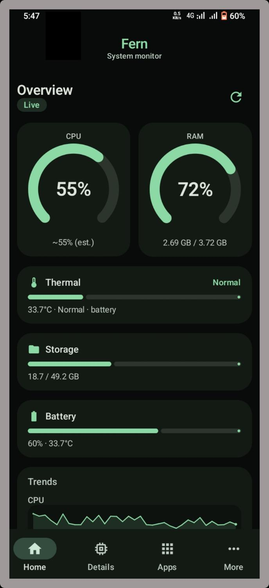
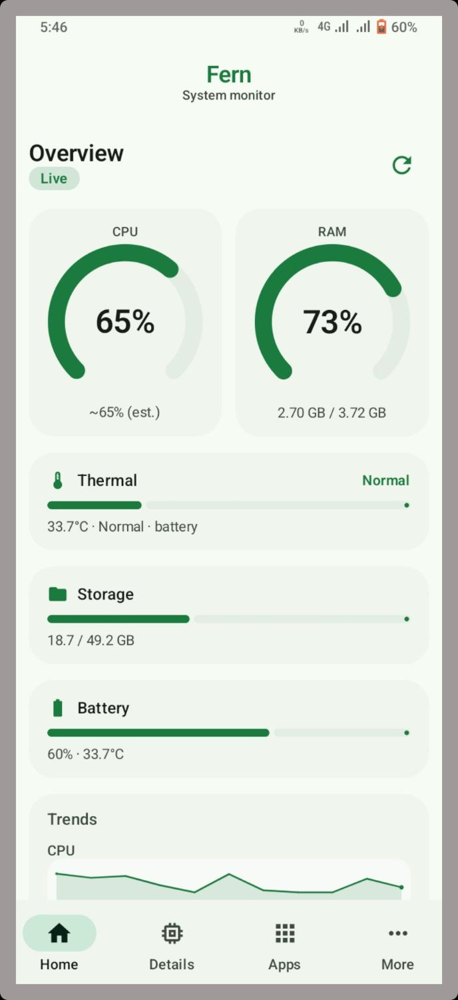
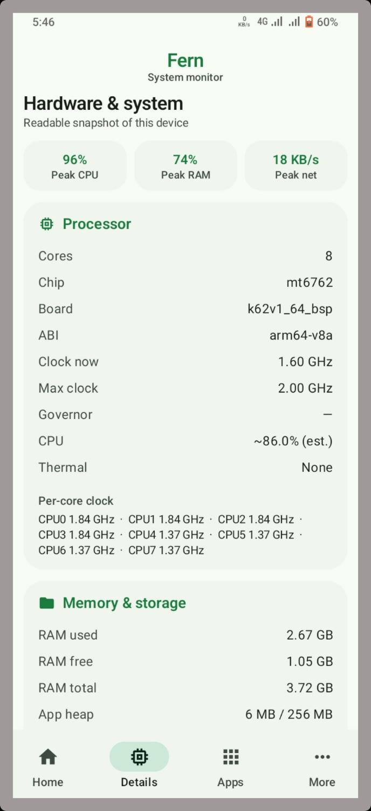
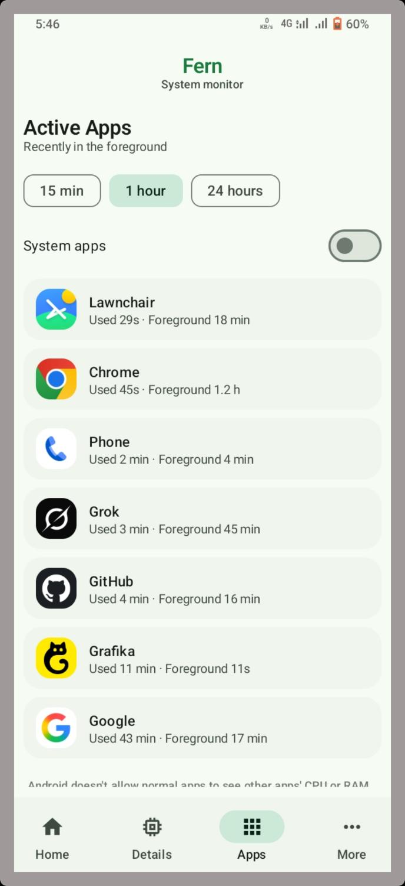
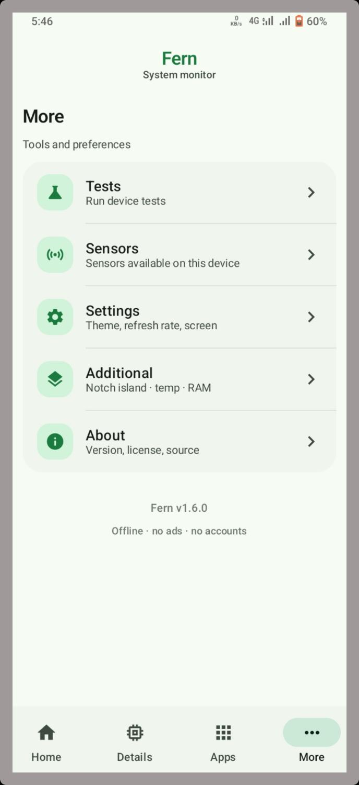

<p align="center">
  
</p>

<h1 align="center">Fern</h1>

<p align="center">
  <b>Live system pulse for Android</b><br/>
  Material You monitor — CPU, RAM, battery, thermals, network.<br/>
  Offline · No ads · No trackers · Optional Shizuku / root
</p>

<p align="center">
  <a href="https://github.com/wized2/Fern/actions/workflows/build.yml"></a>
  <a href="https://github.com/wized2/Fern/releases/latest"></a>
  <a href="https://github.com/wized2/Fern/stargazers"></a>
  <a href="LICENSE"></a>
  
  
</p>

<p align="center">
  <a href="https://get-fern.vercel.app"><b>Website</b></a> ·
  <a href="https://github.com/wized2/Fern/releases/latest"><b>Download APK</b></a> ·
  <a href="#features"><b>Features</b></a>
</p>

## Screenshots

| Home (dark) | Home (light) | Details | Active apps | More |
|:---:|:---:|:---:|:---:|:---:|
|  |  |  |  |  |

## Features

- **Live dashboard** — CPU, RAM, battery, storage, network with smooth history charts  
- **Material You** — seed colors, light / dark / system, AMOLED-friendly dark  
- **Details & peaks** — breakdowns and shareable metric snapshots  
- **Active apps** — process view; per-app CPU / RAM with elevated access  
- **Sensors, tests, about** — under More without cluttering Home  
- **Dynamic Island–style overlay** (optional) — compact temp · RAM  
- **Advanced mode** — Shizuku (preferred) or root for higher-fidelity sampling  
- **Fully offline** — no account, no trackers, no ads  

## Elevated access

Enable **Advanced mode** in Settings → grant Fern in [Shizuku](https://shizuku.rikka.app/) (or use root).  
When connected: richer CPU sampling and per-app memory / CPU on Active apps.

## Privacy

No analytics SDK. Metrics stay on your device. Elevated access only runs what you enable.


## Stable vs beta

| Channel | Branch | Application id |
|---------|--------|----------------|
| Stable | `main` | `com.endroid.fern` |
| Beta / nightly | `beta` | `com.endroid.fern.beta` |

PRs should target **`beta`**. Stable releases are promoted from `beta` to `main`. Both builds can be installed at once.

## Install

```text
https://github.com/wized2/Fern/releases/latest
```

Or build:

```bash
./gradlew assembleRelease
```

## Build

```bash
./gradlew assembleDebug
./gradlew assembleRelease
```

## Related

| Project | What |
|---------|------|
| **[Latch](https://github.com/wized2/Latch)** | Privacy-first Tasker-style automation (local rules, optional Shizuku) |


## Why Fern vs others?

| | Fern | CPU-Z | Simple System Monitor |
|--|------|-------|------------------------|
| Open source | MIT | No | Varies |
| Material You | Yes | No | Limited |
| No ads / trackers | Yes | Ads in free | Often |
| Shizuku per-app stats | Yes | No | Rare |
| Fully offline | Yes | Partial | Often |

## Install options

- [Latest APK](https://github.com/wized2/Fern/releases/latest)
- **Obtainium:** add `https://github.com/wized2/Fern`
- F-Droid-style metadata lives in `fastlane/metadata` (listing pending)

## Related

Also try **[Latch](https://github.com/wized2/Latch)** — privacy-first automation on the same stack.

## Why Fern?

Most monitors are either bloated with ads or need root for basics. Fern aims for a **clean Material You** experience that works offline, with deeper metrics only when you opt into Shizuku.


## Contributing

We want first-time contributors to succeed quickly.

1. Read **[docs/DEVELOPMENT.md](docs/DEVELOPMENT.md)** (5‑minute setup).
2. Branch from **`beta`** and open PRs against **`beta`** (not `main`).
3. Pick a [`good first issue`](https://github.com/wized2/Fern/labels/good%20first%20issue) and comment that you’re on it.

Stable releases are promoted from `beta` → `main`. Beta builds use package id `com.endroid.fern.beta` so both apps can install together.


See [CONTRIBUTING.md](CONTRIBUTING.md). Issues and PRs welcome — especially accessibility, OEM quirks, and chart polish.

## License

[MIT](LICENSE) · Project Endroid

---

<p align="center">If Fern is useful, a <b>star</b> helps others find it ⭐</p>
